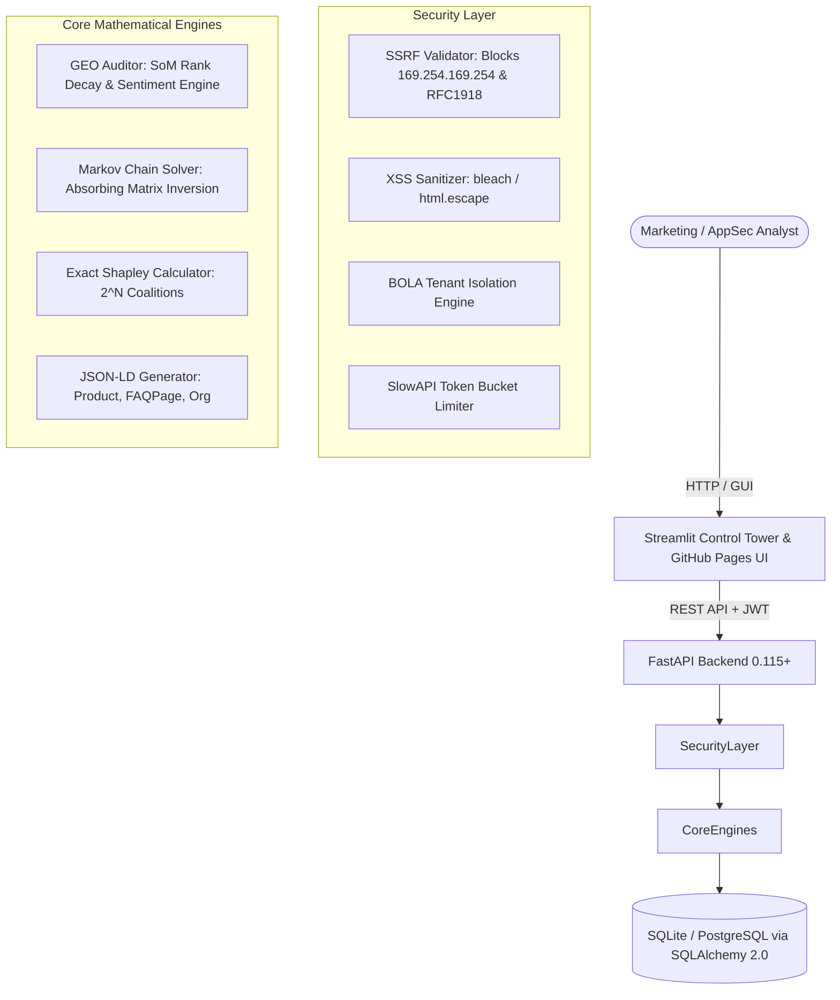

# Generative Engine Optimization (GEO) & Multi-Touch Attribution Sandbox

[](https://www.python.org/)
[](https://fastapi.tiangolo.com/)
[](https://streamlit.io/)
[](https://pytest.org/)
[](https://owasp.org/)
[](LICENSE)
[](https://samuelhtampubolon.github.io/geo-multitouch-attribution-sandbox/)

> **Executive Summary**: A full-stack, mathematically rigorous simulation sandbox combining **Generative Engine Optimization (GEO)** with **Graph-Theoretic Multi-Touch Marketing Attribution (MTA)**. It bridges the gap between AI search brand visibility (ChatGPT, Perplexity, Claude, Gemini) and conversion path attribution using absorbing Markov Chains and axiomatic Shapley values.

---

## 🎯 Business Problems Addressed

| Problem ID | Title | Executive Impact |
| :--- | :--- | :--- |
| **PROB-01** | **Brand Invisibility in Generative Search** | Consumers increasingly query AI engines instead of traditional blue links. Brands are blind to their Share of Model (SoM) citation frequency, rank degradation, and sentiment bias. |
| **PROB-02** | **Flawed Last-Click Marketing Attribution** | Last-Click attribution awards 100% credit to bottom-of-funnel retargeting ads, systematically starving top-of-funnel generative discovery, virtual influencers, and technical content. |

---

## 📐 Mathematical Governing Equations

### 1. Share of Model (SoM) Visibility Score
$$\text{SoM} = \frac{1}{M} \sum_{i=1}^C w_i \cdot \frac{1}{\log_2(\text{rank}_i + 1)} \cdot (1.0 + 0.5 \cdot s_i)$$
- $M$: Total category prompt queries.
- $w_i$: Citation weight ($1.0$ if cited, $0.0$ otherwise).
- $\frac{1}{\log_2(\text{rank}_i + 1)}$: Logarithmic position decay discount.
- $(1.0 + 0.5 \cdot s_i)$: Sentiment multiplier scaled for $s_i \in [-1.0, 1.0]$.

### 2. Markov Chain Removal Effect
Using the fundamental matrix of an absorbing Markov chain:
$$P = \begin{pmatrix} Q & R \\ 0 & I \end{pmatrix}, \quad N = (I - Q)^{-1}, \quad B = N R$$
The channel removal effect $R_k$ measures the drop in conversion when channel $k$ is removed:
$$R_k = 1.0 - \frac{P(\text{Conversion} \mid \text{Graph without } k)}{P(\text{Conversion} \mid \text{Full Graph})}$$
Normalized attribution weight:
$$W_k = \frac{R_k}{\sum_{j} R_j}, \quad \text{where} \quad \sum_k W_k = 1.0$$

### 3. Exact Shapley Value Attribution
Axiomatic cooperative game theory across marketing channels $N$:
$$\phi_k(v) = \sum_{S \subseteq N \setminus \{k\}} \frac{|S|! (|N| - |S| - 1)!}{|N|!} [v(S \cup \{k\}) - v(S)]$$
Guarantees efficiency: $\sum_{k \in N} \phi_k = v(N) - v(\emptyset)$.

### 4. Marginal ROAS & Budget Reallocation
$$\text{ROAS}_k = \frac{\text{Attributed Revenue}_k}{\text{Ad Spend}_k}$$
$$\text{Budget}^*_k = \text{Total Spend} \times \frac{W_k \cdot \text{ROAS}_k^{0.5}}{\sum_j W_j \cdot \text{ROAS}_j^{0.5}}$$

---

## 🏛️ System Architecture



---

## 🛡️ OWASP API Security & Threat Mitigations

- **SSRF Prevention**: Strict `https://` validation. All domain names are resolved via `socket.getaddrinfo`, and connections to private subnets (`10.0.0.0/8`, `172.16.0.0/12`, `192.168.0.0/16`), loopbacks (`127.0.0.0/8`), and AWS/GCP metadata endpoints (`169.254.169.254`) are blocked with HTTP 400.
- **Mass Assignment Mitigation**: All incoming schemas inherit from Pydantic models with `ConfigDict(extra='forbid')`.
- **BOLA Elimination**: Tenant identities are extracted from signed HS256 JWT tokens and cross-verified against requested tenant resource scopes.
- **XSS & Template Injection**: All generated Schema.org JSON-LD scripts are sanitized via `html.escape` and `bleach.clean`.

---

## 🚀 Quickstart & Local Live-Server Startup

### 1. Prerequisites
- Python 3.11+
- Virtualenv (recommended)

### 2. Installation
```bash
# Clone the repository
git clone https://github.com/samuelhtampubolon/geo-multitouch-attribution-sandbox.git
cd geo-multitouch-attribution-sandbox

# Install dependencies
pip install -r requirements.txt
```

### 3. Run Preflight Checks & Test Suite
```bash
python run_local.py --check
```
*Output:*
```text
======================================================================
[*] RUNNING PRE-FLIGHT VERIFICATION & TESTS
======================================================================
[1/2] Initializing and Seeding Offline Corpus...
[OK] Database ready.
[2/2] Running Pytest Verification Suite...
============================= 15 passed in 2.08s ==============================
[OK] ALL TESTS & PREFLIGHT CHECKS PASSED DETERMINISTICALLY
```

### 4. Start Local Servers (FastAPI + Streamlit)
```bash
python run_local.py
```
- **Backend API Docs (Swagger UI)**: [http://127.0.0.1:8000/docs](http://127.0.0.1:8000/docs)
- **Interactive Control Tower (Streamlit)**: [http://127.0.0.1:8501](http://127.0.0.1:8501)
- **Liveness Probe**: [http://127.0.0.1:8000/healthz](http://127.0.0.1:8000/healthz)
- **Readiness Probe**: [http://127.0.0.1:8000/readyz](http://127.0.0.1:8000/readyz)

---

## 🌐 Live GitHub Pages Demo (`github.io`)

Visit the interactive web portfolio and simulation sandbox deployed on GitHub Pages:  
👉 **[https://samuelhtampubolon.github.io/geo-multitouch-attribution-sandbox/](https://samuelhtampubolon.github.io/geo-multitouch-attribution-sandbox/)**

Features included in the web sandbox:
1. **Interactive Customer Journey Funnel** with real-time Sankey diagram visualization.
2. **Generative Engine Prompt Simulator** comparing ChatGPT, Perplexity, Claude, and Gemini citations.
3. **5-Way Multi-Touch Attribution Calculator** (Last-Click, First-Touch, Linear, Markov, Shapley).
4. **Marginal ROAS & Budget Reallocation Simulator**.
5. **Live Schema.org JSON-LD Generator & Validator**.

---

## 📄 License
This project is open-source software licensed under the [MIT License](LICENSE).
