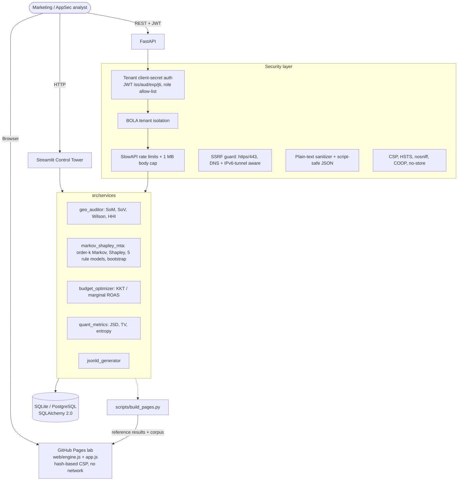

# Generative Engine Optimization (GEO) & Multi-Touch Attribution Sandbox

[](https://github.com/samuelhtampubolon/geo-multitouch-attribution-sandbox/actions/workflows/ci.yml)
[](https://www.python.org/)
[](#-verification--test-suite)
[](SECURITY.md)
[](LICENSE)
[](https://samuelhtampubolon.github.io/geo-multitouch-attribution-sandbox/)

> A mathematically rigorous sandbox that connects **AI-search brand visibility** (Share of Model across ChatGPT, Perplexity, Claude, Gemini) with **conversion-path attribution** (order-k absorbing Markov chains, exact Shapley values) and a **concave marginal-ROAS budget optimizer**, wrapped in an OWASP-hardened FastAPI backend, a Streamlit control tower and a fully client-side GitHub Pages lab.

👉 **Live interactive lab:** <https://samuelhtampubolon.github.io/geo-multitouch-attribution-sandbox/>
All math on the page runs in your browser on the seeded 500-journey corpus, and the page proves live that its JavaScript engine reproduces the Python engine (max |Δ| ≈ 1e-16 for Markov, 0 mismatches for SSRF/sanitizer verdicts).

---

## ✨ What's new in v2.0

| Area | Before (v1) | Now (v2) |
| :--- | :--- | :--- |
| GitHub Pages | Hard-coded "simulated" Markov / Shapley numbers | Real engine in JS (`web/engine.js`): order-k Markov, exact Shapley, optimizer, bootstrap CI; Python parity verified in-page and in CI |
| Attribution models | 5 | 7: + Position-Based (U-shaped 40/20/40), Time-Decay (half-life) |
| Markov chain | First order, explicit inverse | Order k = 1..3, vectorized NumPy, `solve()` instead of `inv()`, expected visits, bootstrap 95% CI |
| Shapley | Silently **dropped channels** above 12 | Exact enumeration ≤ 12 channels, exact unanimity closed form above (never truncates) |
| Budget | Heuristic `W·√ROAS` weights | Concave program `max Σ aₖxₖ^β` with KKT / marginal-ROAS equalization and trust region |
| GEO metrics | Raw SoM only | + normalized SoM, Share of Voice, Wilson CI, HHI, engine entropy, per-engine SoM |
| Model comparison | none | Jensen-Shannon divergence and total variation vs Markov |
| Security | Token endpoint minted **any tenant/role**, rate limiter never attached, `CORS *` + credentials, secrets in git, DOM-XSS in the demo page | Client-secret auth, role allow-list, iss/aud/jti JWT, working rate limits, CORS allow-list, 1 MB body cap, CSP, IPv6/DNS-aware SSRF guard, hashed-CSP static site, no committed secrets |
| Tests | 15 | **166** (math proofs, axioms, security bypasses, API, dashboard, JS parity) |

---

## 🎯 Business Problems Addressed

| Problem ID | Title | Executive Impact |
| :--- | :--- | :--- |
| **PROB-01** | **Brand Invisibility in Generative Search** | Consumers increasingly ask AI engines instead of clicking blue links. Brands are blind to how often, how high and how favourably they are cited (Share of Model). |
| **PROB-02** | **Flawed Last-Click Attribution** | Last-Click gives 100% credit to the final touch. On the seeded corpus it misplaces **46.4%** of conversion credit relative to the Markov model, starving AI search, content and influencer channels. |

---

## 📐 Governing Equations

### 1. Share of Model (SoM) and visibility metrics
$$\text{SoM} = \frac{1}{M} \sum_{i=1}^{C} w_i \cdot \frac{1}{\log_2(\text{rank}_i + 1)} \cdot (1 + 0.5\, s_i), \qquad s_i \in [-1, 1]$$

- Upper bound per evaluation is 1.5, so $\text{SoM}_{norm} = \text{SoM} / 1.5 \in [0, 1]$.
- Share of Voice: $\text{SoV}_b = \text{SoM}_b / \sum_j \text{SoM}_j$; concentration $\text{HHI} = 10000 \sum_b \text{SoV}_b^2$.
- Citation rate $\hat p = k/n$ with the **Wilson score interval**
  $\dfrac{\hat p + \frac{z^2}{2n} \pm z\sqrt{\frac{\hat p(1-\hat p)}{n} + \frac{z^2}{4n^2}}}{1 + z^2/n}$, $z = 1.96$.
- Engine spread: Shannon entropy $H = -\sum_e p_e \log_2 p_e$.

### 2. Order-k absorbing Markov chain and removal effect
States are the last $k$ touches $(c_{t-k+1}, \dots, c_t)$ plus `(start)`, `(conversion)`, `(null)`.
$$P = \begin{pmatrix} Q & R \\ 0 & I \end{pmatrix}, \quad N = (I - Q)^{-1}, \quad B = N R$$
$P(\text{conv}) = B_{\text{start},\text{conv}}$ is obtained by solving $(I - Q)\,b = r_{\text{conv}}$ (no explicit inverse).
$$R_k = 1 - \frac{P(\text{conv} \mid \text{chain without } k)}{P(\text{conv} \mid \text{full chain})}, \qquad W_k = \frac{R_k}{\sum_j R_j}$$
Removing $k$ redirects every state that contains $k$ to `(null)`.

**Flow conservation (proved in tests):** for the maximum-likelihood chain, $N_{\text{start},c}$ equals the observed touches of $c$ per journey and $B_{\text{start},\text{conv}}$ equals the observed conversion rate, for every order $k$. With $k \ge$ the longest path, removal effects equal the exact counterfactual "conversions from journeys that never touched $k$".

**Bootstrap CI:** journeys are resampled as $n^{(b)} \sim \text{Multinomial}(n, \hat\pi)$, the chain is refit and $W_k$ recomputed; the 2.5% / 97.5% percentiles form the 95% interval.

### 3. Exact Shapley value
$$\phi_k = \sum_{S \subseteq N \setminus \{k\}} \frac{|S|!\,(|N| - |S| - 1)!}{|N|!}\,[v(S \cup \{k\}) - v(S)]$$
with $v(S)$ = value of converted journeys whose channel set $T \subseteq S$. Because $v = \sum_T \text{value}(T)\, u_T$ is a sum of unanimity games,
$$\phi_k = \sum_{T \ni k} \frac{\text{value}(T)}{|T|}$$
exactly. Tests verify efficiency ($\sum \phi_k = v(N)$), symmetry, dummy, additivity, and equality of the $2^N$ enumeration with the closed form.

### 4. Rule-based models
- Last-Click, First-Touch, Linear.
- Position-Based (U-shaped): 100% for one touch, 50/50 for two, otherwise 40% first, 40% last, 20% shared by the middle.
- Time-Decay: $w_i \propto 2^{-(L-1-i)/h}$ (credit halves every $h$ touches before conversion).

### 5. Model disagreement
$$\text{JSD}(P\|Q) = \tfrac12 \text{KL}(P\|M) + \tfrac12 \text{KL}(Q\|M), \quad M = \tfrac{P+Q}{2}, \qquad \text{TV}(P,Q) = \tfrac12 \sum_k |p_k - q_k|$$

### 6. ROAS and concave budget optimization
$\text{ROAS}_k = \text{revenue}_k / \text{spend}_k$, $\text{CPA}_k = \text{spend}_k / \text{conversions}_k$.
Each channel follows a diminishing-returns curve $r_k(x) = a_k x^{\beta}$ calibrated at today's spend: $a_k = \text{revenue}_k / s_k^{\beta}$.
$$\max_x \sum_k a_k x_k^{\beta} \quad \text{s.t.} \quad \sum_k x_k = B,\; L_k \le x_k \le U_k$$
KKT gives the unique optimum $x_k^* = \text{clip}\big((\beta a_k / \lambda)^{1/(1-\beta)}, L_k, U_k\big)$ with $\lambda^*$ (equilibrium marginal ROAS, $\text{mROAS}_k = \beta a_k x^{\beta-1}$) found by bisection. Trust region: $L_k = (1-\delta)s_k$, $U_k = (1+\delta)s_k$ (scaled to the budget). Without binding bounds, $x_k^* = B\, a_k^{1/(1-\beta)} / \sum_j a_j^{1/(1-\beta)}$.

On the seeded corpus (β = 0.5, δ = 0.5, $22,500/month) the optimum projects **+12.1% revenue** at **λ\* = 0.62**.

---

## 🏛️ System Architecture



---

## 🛡️ Security (OWASP API Top 10)

See [SECURITY.md](SECURITY.md) for the full threat model. Highlights:

- **Broken authentication (API2):** `POST /api/v1/auth/token` requires the tenant's `client_secret` (constant-time compare, identical error for unknown tenants). JWTs are pinned to HS256 and require `iss`, `aud`, `exp`, `nbf`, `iat`, `jti`, `sub`, `tenant_id`, `role`. Default lifetime 60 minutes.
- **BOLA (API1):** every route compares the token tenant with the requested `tenant_id`; denials never echo the probed tenant.
- **Function-level authorization (API5):** only `analyst` and `viewer` roles can be minted; tokens carrying any other role are rejected; viewers cannot persist results.
- **Mass assignment (API3):** every schema uses `extra='forbid'`; tenant IDs must match `^[a-z0-9][a-z0-9_-]{1,63}$`; enums are `Literal` types.
- **Resource consumption (API4):** global 120/min and auth 10/min rate limits (the v1 limiter was never attached), 1 MB request body cap (HTTP 413), path ≤ 25, journeys ≤ 10,000, channels ≤ 20, Markov order ≤ 3, bootstrap ≤ 500, Shapley closed form above 12 channels.
- **SSRF (API7):** `https` + port 443 only, no userinfo, forbidden characters rejected, internal hostnames (`localhost`, `*.internal`, `metadata.google.internal`, ...) denied, and **every** DNS answer must be globally routable. IPv4 smuggled in IPv6 (mapped, NAT64, 6to4, Teredo), CGNAT `100.64.0.0/10`, IMDS v6 `fd00:ec2::254` are blocked. Resolved IPs are returned for DNS pinning.
- **XSS / injection:** untrusted text is reduced to inert plain text (nested entities, `<script>`/`<svg>` blocks, bidi overrides removed); JSON-LD is serialized with `<`, `>`, `&`, U+2028/2029 and bidi characters escaped, so `</script>` cannot break out, and URLs keep valid `&` query strings.
- **Security misconfiguration (API8):** strict CSP on the API, docs disabled in production, generic 500 and readiness errors, CORS allow-list without credentials, non-root Docker image with `no-new-privileges`, `cap_drop: ALL`, read-only root FS.
- **Secrets:** nothing usable is committed. Development generates an ephemeral JWT key; production refuses to start without a ≥ 32-char `JWT_SECRET` and strong `TENANT_CLIENT_SECRETS`.
- **Static site:** the GitHub Pages lab uses a meta CSP with SHA-256 hashes for its inline script/style, `connect-src 'none'`, no `innerHTML`, no inline handlers.

---

## 🚀 Quickstart

```bash
git clone https://github.com/samuelhtampubolon/geo-multitouch-attribution-sandbox.git
cd geo-multitouch-attribution-sandbox
pip install -r requirements.txt

python run_local.py --check   # seed, 166 tests, Pages freshness check
python run_local.py           # FastAPI :8000 + Streamlit :8501 on 127.0.0.1
```

Windows (PowerShell) works the same way, for example from `C:\Users\<you>\...\geo-multitouch-attribution-sandbox`.

| Service | URL |
| :--- | :--- |
| Streamlit Control Tower | <http://127.0.0.1:8501> |
| Swagger UI (development only) | <http://127.0.0.1:8000/docs> |
| Liveness / readiness | <http://127.0.0.1:8000/healthz>, <http://127.0.0.1:8000/readyz> |

### Calling the API

In development the seeded tenant `tenant-alpha` uses the demo secret `dev-only-demo-client-secret-change-me` (configure real ones with `TENANT_CLIENT_SECRETS`, see `.env.example`).

```bash
TOKEN=$(curl -s -X POST http://127.0.0.1:8000/api/v1/auth/token \
  -H 'Content-Type: application/json' \
  -d '{"tenant_id":"tenant-alpha","client_secret":"dev-only-demo-client-secret-change-me"}' | python -c "import sys,json;print(json.load(sys.stdin)['access_token'])")

curl -s -X POST http://127.0.0.1:8000/api/v1/mta/compute \
  -H "Authorization: Bearer $TOKEN" -H 'Content-Type: application/json' \
  -d '{"tenant_id":"tenant-alpha","markov_order":2,"bootstrap_samples":200,"response_elasticity":0.5,"reallocation_trust_region":0.5,"persist":false}'
```

### Docker

```bash
export JWT_SECRET=$(python -c "import secrets;print(secrets.token_urlsafe(48))")
export TENANT_CLIENT_SECRETS="tenant-alpha:$(python -c "import secrets;print(secrets.token_urlsafe(24))")"
docker compose up --build -d
```

---

## 🌐 GitHub Pages lab

`index.html` and `docs/index.html` are generated by `python scripts/build_pages.py` from `web/template.html`, `web/styles.css`, `web/engine.js` and `web/app.js`. The build:

1. Generates the deterministic 500-journey corpus with the same code as the database seeder.
2. Runs the Python engine to produce reference results (Markov k = 1..3, Shapley, rule models, divergences, optimizer, SSRF and sanitizer verdicts) and embeds them.
3. Hashes every inline script and style into a strict Content-Security-Policy.

The page recomputes everything in the browser and shows a live parity table; `tests/test_pages_build.py` runs the same comparison under Node in CI and fails if the committed pages are stale. Pages is served from the `main` branch (root or `/docs`, both are kept identical).

Sections: Share of Model auditor, attribution lab (seeded or custom journeys, order k, half-life, bootstrap CI, heatmap of 7 models, credit-shift chart, transition matrix), budget optimizer (dumbbell and marginal-ROAS charts), JSON-LD studio with an XSS payload demo, SSRF guard with 12 bypass presets, governing equations (MathML), and verification.

---

## ✅ Verification & Test Suite

```bash
python -m pytest -v            # 166 tests
python scripts/build_pages.py --check
make security                  # bandit + pip-audit
```

| File | Tests | What it proves |
| :--- | ---: | :--- |
| `test_attribution_math.py` | 33 | Hand-derived removal effects, solver vs value iteration, flow conservation for k = 1..3, exact counterfactual at full memory, Shapley axioms, closed form = 2^N enumeration, rule models, pipeline invariants, sub-100 ms |
| `test_quant_and_budget.py` | 23 | Wilson reference values, HHI, entropy, JSD/TV properties, KKT optimality, closed form, bounds, global optimum vs 300 random feasible points |
| `test_geo_and_jsonld.py` | 19 | SoM bounds and recomputation, SoV/HHI consistency, determinism, sanitized names, JSON-LD break-out and URL safety |
| `test_ssrf_and_security.py` | 66 | SSRF bypasses (IPv6 tunnels, DNS answers, decimal/hex IPs, userinfo, ports), sanitizer payloads, JWT forgery (`alg=none`, wrong key, audience, expiry, role), schema bounds, production config, Trojan Source |
| `test_api_integration.py` | 13 | Auth, BOLA over HTTP, viewer role, rate limiting (429), 413 body cap, CORS allow-list, security headers, end-to-end endpoints |
| `test_dashboard_smoke.py` | 4 | Streamlit app renders headlessly with computed KPIs; tenant validation; SSRF tool |
| `test_pages_build.py` | 8 | Pages are current, CSP hashes match, no inline handlers or HTML-string sinks, Node JS/Python parity |

CI (`.github/workflows/ci.yml`) runs the suite on Python 3.11, 3.12 and 3.13 with Node 22, checks the Pages build, and runs bandit and pip-audit. Dependabot keeps pip packages and actions current.

### Breaking changes from v1
- `POST /api/v1/auth/token` now requires `client_secret`; `role` accepts only `analyst` or `viewer`.
- `recommended_budget_reallocation_usd` now comes from the concave optimizer; new fields include `position_based_share`, `time_decay_share`, `markov_share_ci_low/high`, `marginal_roas_current/optimized`, `cpa_markov`, `model_divergence_vs_markov` and projected revenues.
- `GeoAuditRequest.persist` defaults to `false` (audits no longer grow the table on every call).
- `data/geo_mta.db` is no longer committed; it is recreated deterministically on startup.

---

## 📁 Project Structure

```
src/
  api/            main.py (middleware, headers, probes), routes_geo_mta.py, rate_limit.py
  services/       geo_auditor.py, markov_shapley_mta.py, budget_optimizer.py, quant_metrics.py, jsonld_generator.py
  ui/dashboard.py Streamlit Control Tower
  config.py  security.py  schemas.py  models.py  database.py  seed_journeys.py
web/              template.html, styles.css, engine.js, app.js, test_summary.json
scripts/          build_pages.py, js_parity.js
tests/            7 test modules, conftest.py (isolated temp DB)
index.html, docs/index.html   generated GitHub Pages lab
```

## 📄 License
MIT, see [LICENSE](LICENSE).
